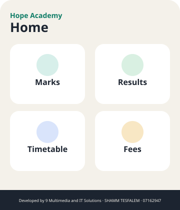

# School admin

You see the whole school. Teachers do not set the yearly fee or the utility fee. You do.

## School page

Tap **School**. It shows students, fees already paid, fees still to pay, and the money balance. Tap the refresh icon to update it.

## Money

Tap **Money**.

- **In** is money that is not a student fee. Student fees are added on their own.
- **Out** needs a short reason, the date, and the receipt number. The cheque number is optional.
- **Workshops** is the money paid for workshops, with the date or the number of days.
- **Sports** is kept separate from other spending.

The balance is income minus expenses, workshops, sports and the utility fee.

## Staff

Tap **Staff**. You can see teaching and non-teaching staff, boys and girls, and the qualification counts.

## Absence

Tap **Absence**. Choose a teacher and tap **Mark away today**. The lost periods come from that teacher's timetable. If the school is not using the timetable, set the teacher's weekly periods instead. **Add a make-up class** reduces the periods lost.

## Timetable

Tap **Timetable**, then **Make the timetable**. Drag a lesson onto another period. If that causes two classes for one teacher, the app says so and does not move it.

## Settings

Set the yearly fee, the utility fee, and how many failed subjects fail a student in elementary, junior and high school. You can lock the six parts of the 60% so teachers follow the school weights.

## Backup

Tap **Backup now**. Copies are kept in the folder you set, which can be a USB stick on the school computer. Tap an older copy and confirm to put it back. The current records are replaced only after you say yes.

## Sample school

The first start includes a sample school. In **Settings**, tap **Remove sample data** when the real school is ready. Your admin login stays.
