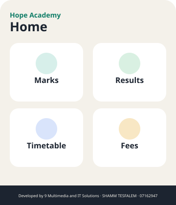

# Homeroom teacher

You can do everything a subject teacher can do, plus your own class.

## Class list

Tap **My class**. You see how many students, boys and girls are on the roll.

Tap **Left school** when a student leaves. You can tap **Undo** if that was a mistake. The office page counts who left, by boys, girls and reason.

## Fees

The fee is paid once in the year. There is no discount.

Tap **Fees**. Green means nothing is left to pay. Red means some money is still owed. Tap a student and type the amount on the number pad. The app will not take more than the fee that is left.

## Marks and results

Use **Marks** and **Results** the same way as a subject teacher. Your class result list is the one to read at the end of the semester.
