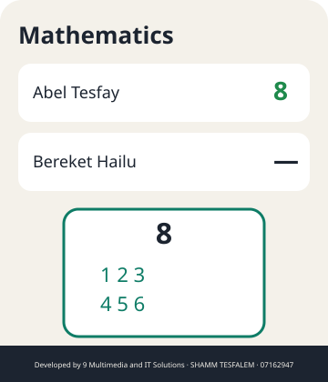

# Teacher

You teach your own subjects. Sign in with the name the office gave you.

## Enter marks

1. Tap **Marks**.
2. Tap the class and subject.
3. Tap **First half** or **Second half** when you start a new mark. The exam is already there.
4. Tap a student. A number pad opens. Type the mark and tap **Save**.
5. Green means the mark is in. Tap **Undo** if the last one was wrong.

If the phone is not on the school Wi-Fi, the mark stays on the phone. Tap **Send** when you are back at school. If the office already changed that mark, the phone keeps the school copy and tells you.

## Results

Tap **Results**, then the class. Green means promoted. Red means failed. The rank skips after a tie: 1, then 2, then 2, then 4.

## Timetable

Tap **Timetable** to see your week.
